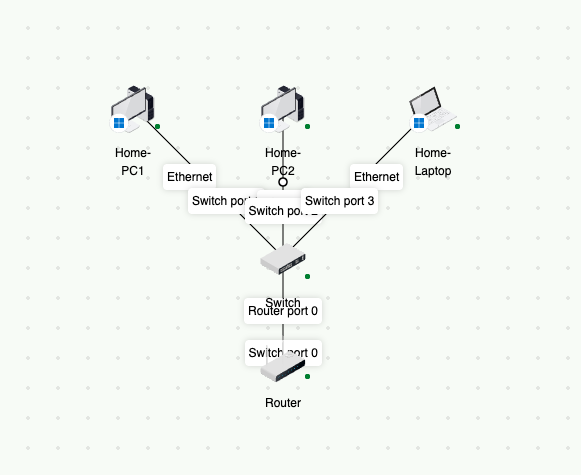
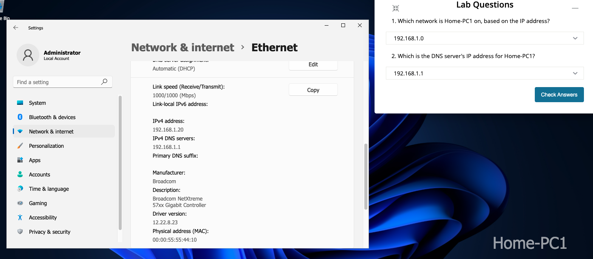
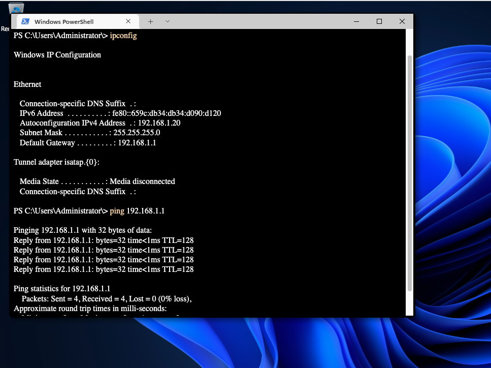

# Networking-Labs
Hands-on networking labs covering IPv4 addressing, DNS, DHCP, and network troubleshooting, with screenshots and explanations.
# Networking Lab: IPv4, DNS, and Gateway Connectivity

## Objective
Identify Home-PC1’s network settings and test connectivity to its default gateway.

## Environment
- Windows 11
- Home-PC1, Home-PC2, and a laptop connected to a switch
- Switch connected to a router

## Network Topology

## Procedure
1. Open Settings → Network & internet → Ethernet.
2. Record Home-PC1’s IPv4 address and DNS server.
3. Open PowerShell and run `ipconfig` to identify the subnet mask and default gateway.
4. Run `ping 192.168.1.1` to test connectivity to the gateway.

## Results

| Setting | Value |
|---------|-------|
| IPv4 address | 192.168.1.20 |
| Subnet mask | 255.255.255.0 (/24) |
| Network address | 192.168.1.0 |
| DNS server | 192.168.1.1 |
| Default gateway | 192.168.1.1 |
| IP and DNS assignment in Settings | Automatic (DHCP) |
| Gateway ping | 4 packets sent, 4 received, 0% loss |

### IPv4 and DNS Settings

### IP Configuration and Gateway Test

## What I Learned
I practiced finding network settings through Windows Settings and PowerShell. Using the IPv4 address and subnet mask, I identified the network as 192.168.1.0/24. The successful ping confirmed that Home-PC1 could reach its default gateway.
